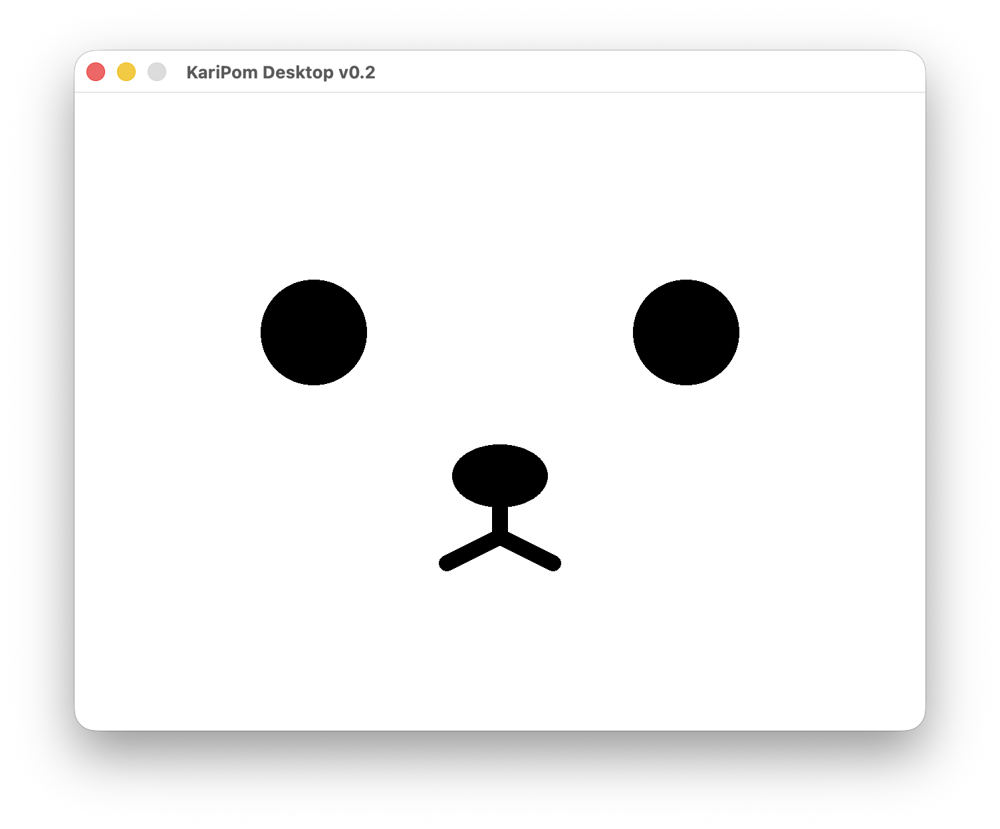

# 🐰 KariPom Desktop

ChatGPTの声に合わせて、画面のキャラクターがリアルタイムに口パク！
KariPom Desktopは、PCから再生される音声を解析し、画面上の「かりポム」が声に合わせて口を動かすデスクトップアプリです。
瞬きしたり、鼻をヒクヒクさせたりしながら、ChatGPTとの音声会話をちょっと楽しくします。

元々は、Arduino/CoreS3で作った顔ロボット「かりポム」の口パク機能から生まれた、PC単体で楽しめるスピンアウト版です。

KariPom Desktopは、ChatGPTなどPCから再生される音声を解析し、その声に合わせて画面上の「かりポム」が口を動かすPythonアプリです。

会話していないときも、瞬きしたり、鼻をヒクヒクさせたりしながらPCの中で過ごします。

さらに、口パクする通常の「顔」も含めて全7種類のオーディオビジュアライザーを搭載。KariPom Desktopの画面をクリックするたびに、順番に切り替わります。どのビジュアライザー表示中も、かりポムの顔は常に最前面に描かれるので、表示を切り替えても「かりポムと話している感覚」は変わりません。

## ✨ Features

- ChatGPTなどPCから再生される音声に合わせた口パク
- 瞬き
- 鼻のヒクヒク動作
- 口パクする顔を含む、全7種類のオーディオビジュアライザー
- 画面クリックでビジュアライザーを順番に切り替え
- どのビジュアライザーでも、かりポムの顔を最前面に表示
- 起動時に標準ブラウザでChatGPTを表示し、その後KariPom Desktop画面を前面に戻す
- 起動時の音声ガイダンス
- macOS / Windows / Linux対応設計
- Arduino・M5Stackなどの専用ハードウェア不要

## 💻 対応状況

- **macOS：実機動作確認済み**
- **Windows：実機動作確認済み**
- **Linux：実機動作確認済み**

## 🚀 セットアップもAIと一緒に

Pythonに詳しくなくても大丈夫です。

1. `karipom_desktop.py` をPCに保存します。
2. `karipom_desktop.py` をChatGPTに添付します。
3. 付属の `KariPom_Desktop_導入ガイド.pdf` に記載された依頼文をChatGPTへ送ります。
4. 自分のOS・Python・音声環境に合わせて、ChatGPTと一緒にセットアップを進めます。

エラーが出た場合も、その表示をChatGPTに見せながら原因を1つずつ確認できます。

💡 動かして終わりにせず、「次回からはターミナルを使わず、ダブルクリックだけで起動できるランチャー（例：macOS／Linuxなら`.command`や`.desktop`、Windowsなら`.bat`）まで作ってほしい」とChatGPTに依頼するのがおすすめです。どんな形のランチャーが適切かは、実際にセットアップを行うAIがお使いの環境に応じて判断します。

詳しい手順は **`KariPom_Desktop_導入ガイド.pdf`** をご覧ください。

## 🎙️ macOSについて

macOSでは、PCから再生される音声を取得するために **BlackHole 2ch** などの仮想オーディオデバイスを利用します。

Macのスピーカーから音を出しながらBlackHoleにも同じ音声を送るには、Audio MIDI設定で「複数出力装置」の設定が必要です。

詳しくは付属の導入ガイドとChatGPTによるセットアップ案内をご利用ください。

## 🐰 How it works

KariPom Desktopは、ChatGPT APIと直接連携して口を動かす方式ではありません。

PCから実際に再生される音声を解析し、その音声に合わせてかりポムが口パクします。

そのため、ChatGPTをはじめ、PCから音声を再生するさまざまな用途への応用が可能です。

## 📄 License

ソースコードは **MIT License** で公開しています。

Copyright (c) 2026 Kariage POMPADOUR Entertainment Corporation

### KariPom / かりポム ブランドについて

MIT Licenseは、このリポジトリに含まれるソフトウェアコードの利用条件を定めるものです。

**「KariPom」「かりポム」の名称、ロゴ、キャラクターその他のブランド要素について、MIT Licenseによる使用許諾を与えるものではありません。**

---

## Welcome to KariPom World!

ChatGPTと音声会話を始めれば、あなたのPCにも、かりポムがやってきます。
